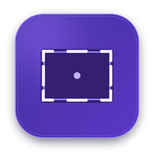
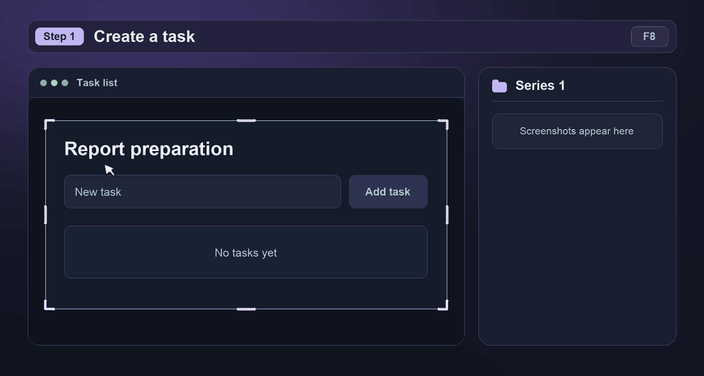

<div align="center">
  
  <h1>ShotSeries</h1>
  <p><strong>One region. One key. A folder for every series.</strong></p>
  <p>Native screenshot tools for macOS and Windows</p>
  <p>English · <a href="README.ru.md">Русский</a></p>
</div>



Building a step-by-step guide? Select a region once, then press **F8** after each step. ShotSeries saves the screenshots in order as `1.png`, `2.png`, and so on in the current series folder.

## How it works

1. **Select a region.** Open ShotSeries from the macOS menu bar or the Windows notification area. Choose **Select area** (**Выделить область**) and drag over the part of the screen to capture. Drag any edge or corner to resize the frame later.
2. **Start a series.** Choose a parent folder and press **+**. ShotSeries creates and selects a subfolder such as `Серия 1` (Series 1). Pick an existing series from the list to switch back.
3. **Capture with F8.** Files go straight into the selected series as `1.png`, `2.png`, and so on. An existing folder picks up after its highest numbered PNG.

Clicks and scrolling pass through the shade to the app underneath. The resize handles stay interactive. You can hide the frame and keep capturing the saved region. The region belongs to one display. ShotSeries saves the selected region, series, and hotkey between launches.

## Build from source

```sh
git clone https://github.com/kultvio/shot-series.git
cd shot-series
```

### macOS

ShotSeries runs on macOS 14 or newer. Build with Xcode 16 or newer, or the corresponding Command Line Tools with Swift 6.

```sh
./build.sh
open build/ShotSeries.app
```

On the first capture, grant ShotSeries screen recording access in System Settings. If macOS asks you to restart ShotSeries, reopen it and press F8 again. [Apple’s screen recording settings guide](https://support.apple.com/guide/mac-help/mchld6aa7d23/mac)

The frame can stay visible in full-screen Spaces and Split View. If the top row controls playback or brightness, try **Fn + F8** or change the hotkey next to **Capture** (**Снять кадр**).

### Windows

On Windows 11 x64, install Rust 1.85 or newer and Visual Studio Build Tools with the **Desktop development with C++** workload. [Rust installation guide](https://doc.rust-lang.org/book/ch01-01-installation.html)

```powershell
cd Windows
cargo run --release --locked
```

Cargo builds the executable at `Windows\target\release\shotseries.exe`, relative to the repository root. The local build is unsigned, so Smart App Control may block it depending on the PC's policy. [Microsoft's Smart App Control guide](https://learn.microsoft.com/windows/apps/develop/smart-app-control/overview)

## Project layout

| Platform | Implementation | Entry points |
| --- | --- | --- |
| macOS | Swift, AppKit, SwiftUI, ScreenCaptureKit | [Overlay](Sources/SelectionOverlay.swift), [capture](Sources/Capture.swift), [storage](Sources/ScreenshotFiles.swift) |
| Windows | Rust, Win32, GDI and GDI+ | [Controls](Windows/src/controls.rs), [overlay](Windows/src/overlay.rs), [capture](Windows/src/desktop.rs), [storage](Windows/src/storage.rs) |

Captures are saved locally. If you run into an issue, include your OS version, display scaling, and the steps to reproduce it. [Report an issue](https://github.com/kultvio/shot-series/issues/new)
