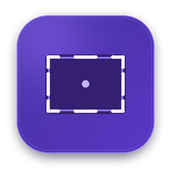
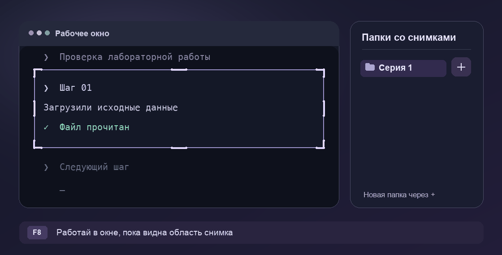

<div align="center">
  
  <h1>ShotSeries</h1>
  <p><strong>Одна область, одна клавиша, отдельная папка для каждой серии.</strong></p>
  <p>Нативная утилита для скриншотов на macOS и Windows</p>
  <p><a href="README.md">English</a> · Русский</p>
</div>



ShotSeries оставляет на экране рамку, размер которой можно менять, пока вы работаете в окне под ней. Нажимайте **F8** после каждого шага, а кнопкой **+** начинайте новую серию. Так удобно собирать скриншоты для инструкций, лабораторных работ и баг-репортов.

## Как пользоваться

1. **Выделите область.** Откройте ShotSeries из строки меню macOS или области уведомлений Windows. Нажмите **Выделить область** и обведите нужную часть экрана. Чтобы подправить размер рамки, потяните за край или угол.
2. **Начните серию.** Выберите основной каталог и нажмите **+**. ShotSeries создаст и выберет подкаталог, например `Серия 1`. Переключаться между существующими сериями можно в списке.
3. **Снимайте по F8.** Файлы сразу появляются в выбранной серии как `1.png`, `2.png` и далее. В существующей папке нумерация продолжится после самого большого номера PNG.

Клики и прокрутка проходят через затемнение в рабочее окно. Ручки рамки остаются доступны для перетаскивания. Рамку можно скрыть и продолжить снимать сохранённую область. Область привязана к одному дисплею. Выбранная область, серия и клавиша запоминаются между запусками.

## Сборка из исходников

```sh
git clone https://github.com/kultvio/shot-series.git
cd shot-series
```

### macOS

ShotSeries работает на macOS 14 и новее. Для сборки нужны Xcode 16 или новее либо соответствующие Command Line Tools со Swift 6.

```sh
./build.sh
open build/ShotSeries.app
```

При первом снимке разрешите ShotSeries запись экрана в Системных настройках. Если macOS предложит перезапустить приложение, откройте его снова и нажмите F8. [Настройки записи экрана в руководстве Apple](https://support.apple.com/guide/mac-help/mchld6aa7d23/mac)

Рамка может оставаться видимой в полноэкранных Spaces и Split View. Если верхний ряд управляет яркостью или воспроизведением, попробуйте **Fn + F8** или смените клавишу в меню рядом с кнопкой **Снять кадр**.

### Windows

На Windows 11 x64 установите Rust 1.85 или новее и Visual Studio Build Tools с компонентом **«Разработка классических приложений на C++»**. [Руководство по установке Rust](https://doc.rust-lang.org/book/ch01-01-installation.html)

```powershell
cd Windows
cargo run --release --locked
```

Cargo создаёт файл `Windows\target\release\shotseries.exe` относительно корня репозитория. Локальная сборка не подписана, поэтому «Интеллектуальное управление приложениями» может заблокировать запуск в зависимости от политики ПК. [Руководство Microsoft по Smart App Control](https://learn.microsoft.com/windows/apps/develop/smart-app-control/overview)

## Структура проекта

| Платформа | Технологии | Основные файлы |
| --- | --- | --- |
| macOS | Swift, AppKit, SwiftUI, ScreenCaptureKit | [Рамка](Sources/SelectionOverlay.swift), [захват](Sources/Capture.swift), [хранение](Sources/ScreenshotFiles.swift) |
| Windows | Rust, Win32, GDI и GDI+ | [Панель](Windows/src/controls.rs), [рамка](Windows/src/overlay.rs), [захват](Windows/src/desktop.rs), [хранение](Windows/src/storage.rs) |

Снимки хранятся локально. Если столкнулись с ошибкой, укажите версию ОС, масштаб дисплея и шаги воспроизведения. [Сообщить об ошибке](https://github.com/kultvio/shot-series/issues/new)
